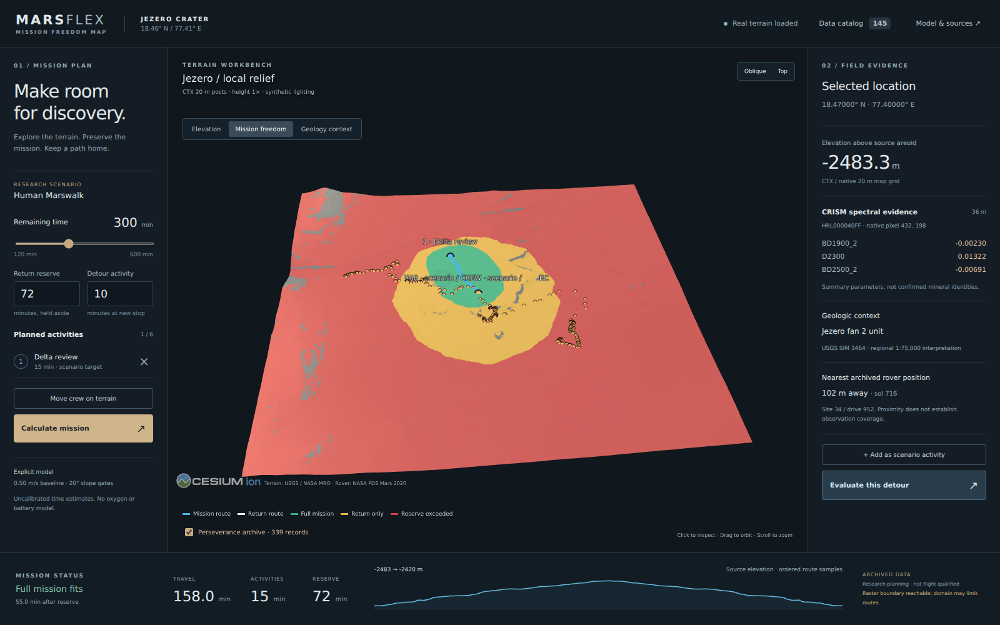

# MarsFlex — Jezero Marswalk Planner

NASA Space Apps Challenge 2026 · *Interplanetary Survival Guide: Martian Map*

MarsFlex layers NASA Mars data for a hyper-local view of Jezero Crater (Perseverance landing region) and
plans scenario walks for a human explorer: terrain-aware routes, optional science stops, a time and
metabolic budget, and traceable orbital/rover evidence for every number shown.

Data layers: CTX and HiRISE terrain (MRO/USGS), CRISM spectral parameters, USGS geologic units,
PIXL rover measurements, and archived Perseverance MEDA weather.
Green/Yellow/Red denotes feasibility under declared scenario assumptions; it is **not** an operational
safety certification. Details: [docs/science/MODEL_ASSUMPTIONS.md](docs/science/MODEL_ASSUMPTIONS.md).



## Run it

Requires Python 3.12+ and internet access on first launch (installs pinned dependencies into `.marsflex-venv`).

- Windows: double-click `Start_MarsFlex.cmd`
- Any OS: `python launch.py`

Then open http://127.0.0.1:8000. The prebuilt web app (`frontend/dist`) is served by the same process as the API.

## Repository layout

```
backend/    Python API and data pipeline
  marsflex/   FastAPI service, terrain engine, evidence and MEDA modules
  pipeline/   Scripts that fetch and rebuild data/derived from NASA/USGS sources
  tests/      pytest suite (+ tests/browser: Playwright end-to-end checks)
  analysis/   Parameter-sensitivity study and its saved results
frontend/   React + Cesium + Three.js web app (src/, built into dist/)
data/       source/ (NASA/USGS inputs) and derived/ (computed layers used at runtime)
docs/       api/, science/ (methods, sources), legal/ (attributions, licenses), submission/
launch.py, Start_MarsFlex.cmd   one-step local launcher
```

## Develop and test

```
python -m pip install -r backend/requirements-tested.txt
python -m pytest                       # backend tests
python -m uvicorn marsflex.api:app --app-dir backend --port 8000
cd frontend && npm install && npm run dev      # Vite dev server, proxies /v1 to :8000
cd frontend && npm run build                   # rebuilds frontend/dist
```

API reference: [docs/api/API.md](docs/api/API.md).

## Sources, attribution and AI use

- Data sources and terms: [docs/legal/DATA_SOURCES.md](docs/legal/DATA_SOURCES.md), [docs/legal/ATTRIBUTIONS.md](docs/legal/ATTRIBUTIONS.md), [docs/science/SOURCES_EN.md](docs/science/SOURCES_EN.md)
- Third-party software licenses: [npm](docs/legal/THIRD_PARTY_NOTICES_NPM.md), [Python](docs/legal/THIRD_PARTY_NOTICES_PYTHON.md)
- AI assistance disclosure: [docs/submission/AI_ASSISTANCE.md](docs/submission/AI_ASSISTANCE.md)
- Known gaps: [docs/submission/DELIVERY_GAPS.md](docs/submission/DELIVERY_GAPS.md)

NASA does not endorse this project. Original code: Apache-2.0 (see [LICENSE](LICENSE)); external data and assets keep their own terms.
